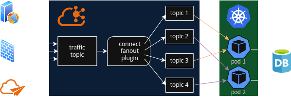
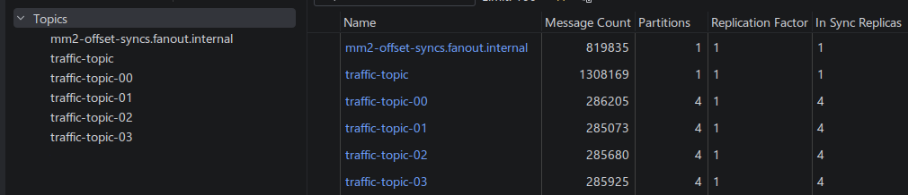
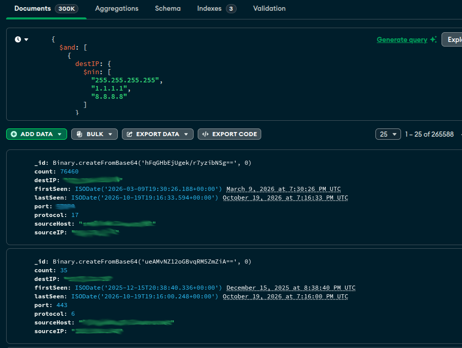

# Network Traffic Monitor

## Zero trust

My firewall limits what traffic can be initiated from external sources, but there is no restriction on outgoing connections initiated internally. Management of servers is limited to 1 person, making the likelihood of compromise minimal. However, the “users” segment is replete with WiFi devices and a couple of hard-wired devices.

Having insight into connections made by users is indispensable. While Pi-Hole is one layer of defense, websites can contain hyperlinks which point directly to addresses.

### Tracking connections

Every network packet does not need to be inspected, only outgoing packets which are not in the state table. A specially-crafted iptables rule captures those and logs them, which is then picked up by ulogd2. My C++ log scraper (should be a ulogd2 plugin) publishes a Kafka message, which is then sent to 1 of 4 topics by my [custom Kafka Connect plugin](https://github.com/davidr69/kafka-connect-fanout), using round-robin. Depending on how many messages were received in the batch, an upsert is made in MongoDB with qualifying messages:



Aside from the main topic and the 4 subtopics, Kafka Connect implicitly creates another topic internally:



## Persisting messages

In order to perform the aforementioned upserts, we must first locate the document that contains the statistics for the destination. A string is crafted and hashed using XXH128, which produces 16 bytes. A Java `Long` is 8 bytes, so 2 Longs can hold the hash. Those 2 Longs are used as the index, rather than maintaining a separate hash field and indexing it:

```javascript
db.createCollection("allTraffic", {
    validator: {
        $jsonSchema: {
            bsonType: "object",
            required: ["_id"],
            properties: {
                _id: {
                    bsonType: "binData",
                    description: "Must be a 16-byte binary value (XXH128)"
                },
                sourceIP: { bsonType: "string" },
                sourceHost: { bsonType: "string" },
                destIP: { bsonType: "string" },
                protocol: { bsonType: "int" },
                port: { bsonType: "int" },
                firstSeen: { bsonType: "date" },
                lastSeen: { bsonType: "date" },
                count: { bsonType: "int" }
            }
        }
    },
    validationLevel: "strict",
    validationAction: "error"
});
```

This approach is very performant, easily accommodating 30,000 upserts per second on a MongoDB instance hosted on a SoC device.

Inserting data manually can be done with:

```javascript
db.allTraffic.insertOne({
    _id: new BinData(0, 'D4AtlJhg9vlO6shQxBE8sA=='),
    sourceIP: '192.168.1.42',
    destIP: '8.8.8.8',
    protocol: 17,
    port: 53,
    lastSeen: ISODate('2025-10-26T22:32:59.023664-0400'),
    firstSeen: ISODate('2025-10-26T22:32:59.023664-0400'),
    sourceHost: 'foobar.lavacro.net',
    count: 1
});
```

MongoDB Compass can be used to view the data:


